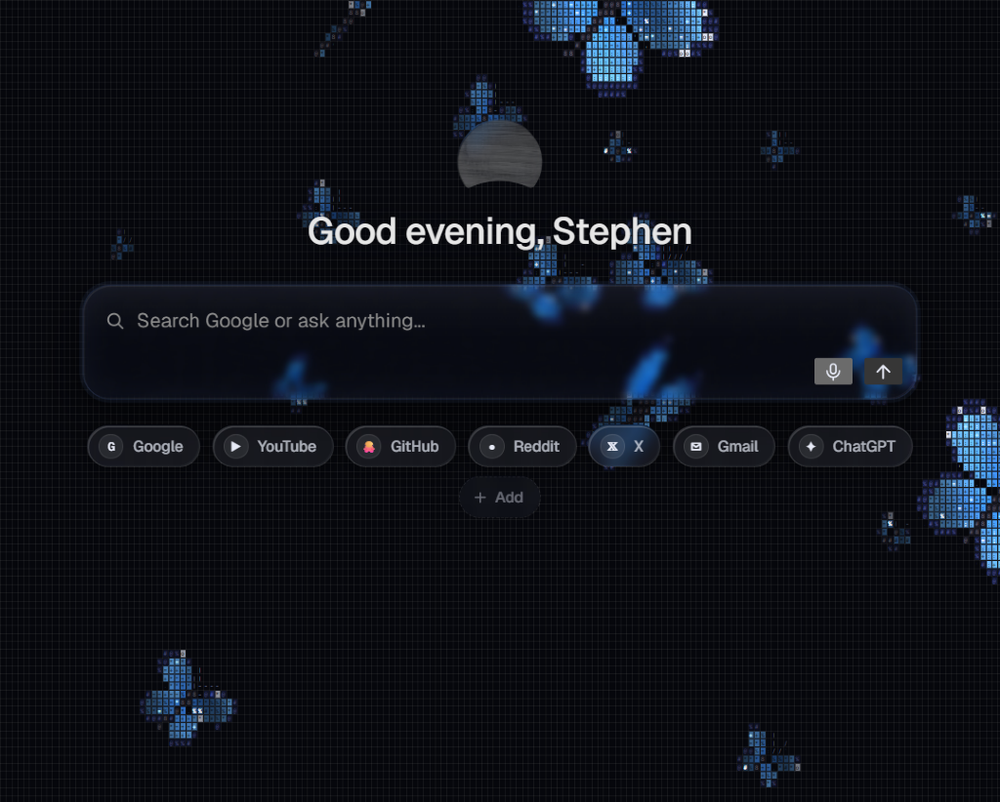
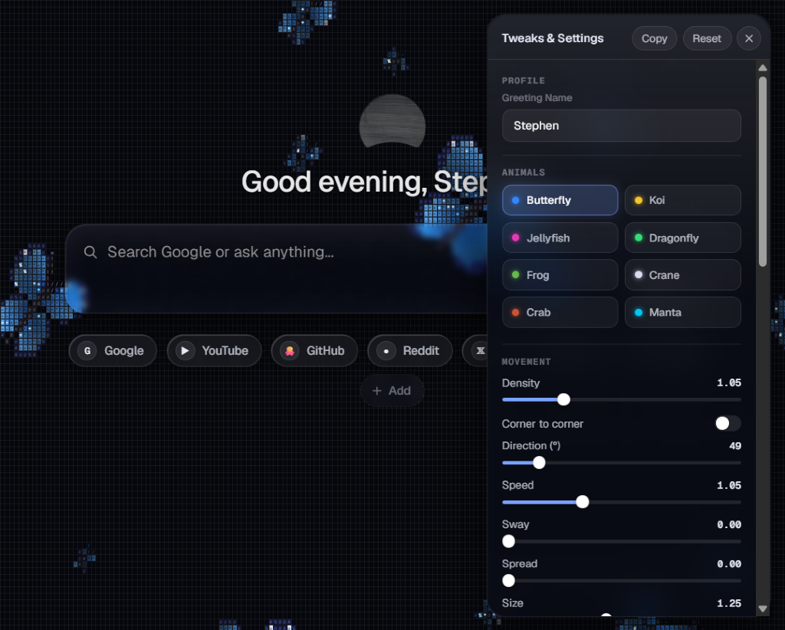

# ASCII Animals · Aesthetic New Tab Extension

> Breathtaking ASCII wildlife crossing your new tab screen with liquid glass UI, quick search, interactive shortcuts, and 8 animated species. Zero dependencies.



---

## ✨ Features

- **8 Animated ASCII Species**:
  - 🦋 **Butterfly** — Blue morphos on migration: flutter, zigzag, glide with wings flat.
  - 🐟 **Koi** — Lazy S-curves on bendy spines; kohaku, sanke, showa, ogon, and chagoi; tap to drop food.
  - 🪼 **Jellyfish** — Bioluminescent magenta: each pulse lights the bell up, then the glow eases out; frilly twisting arms, marine snow.
  - 🪲 **Dragonfly** — Emerald hawkers: hover, dart, cruise along; glinting veined wings.
  - 🐸 **Frog** — Spotted leopard frogs that sit, breathe, and blink, then leap in an arc with a landing splash.
  - 🦩 **Crane** — Red-crowned cranes: majestic wing flaps with splayed fingers, gliding, and folding wrist upstrokes.
  - 🦀 **Crab** — Scuttle sideways in bursts, stepping legs, sand footprints; tap to bolt with claws up.
  - 🌊 **Manta Ray** — Oceanic giant manta with smooth undulating pectoral wing-waves, cephalic horns, chevron shoulders, and flexible trailing whip tail.
- **Minimal, Distraction-Free View**: No permanent top bars or buttons cluttering the canvas.
- **1-Second Edge Hover Tweaks Drawer**: Keep your mouse cursor at the right or left edge of the screen for 1 second to smoothly slide in the Tweaks & Settings panel.
- **Functional Search & URL Navigation**: Pressing <kbd>Enter</kbd> in the center composer performs a Google search or navigates directly if you enter a URL.
- **Liquid-Glass Shortcuts Bar**: Quick access to Google, YouTube, GitHub, Reddit, X, Gmail, and ChatGPT directly below the search bar, with support for adding and deleting custom shortcuts.
- **Personalized Greeting**: Customize the greeting name in the Tweaks panel (or click your name on the new tab page) to personalize your dashboard in real-time.
- **Candidate Lab (`compare.html`)**: Interactive testing environment to explore and compare animal candidate variations.



---

## 🚀 How to Install as a Browser Extension

### 1. Build the Extension
```sh
npm install
npm run build
```
This compiles the production extension into the `dist/` directory.

### 2. Load in Chrome, Edge, or Brave
1. Open your browser and navigate to `chrome://extensions` (or `edge://extensions`).
2. Toggle on **Developer mode** in the top-right corner.
3. Click **Load unpacked**.
4. Select the `dist` folder inside this repository:
   ```
   path/to/ascii-animals/dist
   ```
5. Open a new tab and enjoy!

---

## 💻 Local Development

```sh
npm install
npm run dev
```
Open `http://localhost:5173` in your browser.

- `index.html`: The main New Tab dashboard.
- `compare.html`: The candidate comparison lab.

---

## 🛠️ Architecture

- `src/flock.ts`: The shared simulation environment (population, depth, course, re-entry, startle mechanics).
- `src/renderer.ts`: Procedural ASCII renderer and pen tools (supersampled silhouettes, line glyphs, trails).
- `src/animals/*.ts`: Individual animal behaviors, geometric shapes, shaders, and custom tuning knobs.
- `src/animals/manta.ts`: The Oceanic Manta Ray simulation with undulating wave mechanics.
- `panel.ts`: The edge-hover Tweaks drawer with profile name editor and animal switcher.
- `ui.ts`: Shortcuts management, Google search navigation, and time-aware greeting logic.

---

## 📜 Credits & Attribution

This project is built from [DesignerStephen1/ascii-animals](https://github.com/DesignerStephen1/ascii-animals).

We took Stephen's beautiful ASCII animals concept and made it even better:
- Transformed it into a complete, standalone browser **New Tab Extension** (Manifest V3).
- Added the **Oceanic Manta Ray** with undulating pectoral wave dynamics, cephalic horns, and trailing whip tail.
- Made all inputs and buttons **fully functional**, including real web searches and URL navigation.
- Added a **liquid-glass quick shortcuts bar** with custom bookmark adding and deleting.
- Replaced top-bar clutter with a sleek **1-second edge-hover gesture** to reveal the Tweaks drawer.
- Added a **profile greeting name customizer** in the Tweaks panel that updates and persists in real time.
- Fixed all layout stacking bugs for a clean, pixel-perfect user experience.

---

## 📄 License

MIT License.
